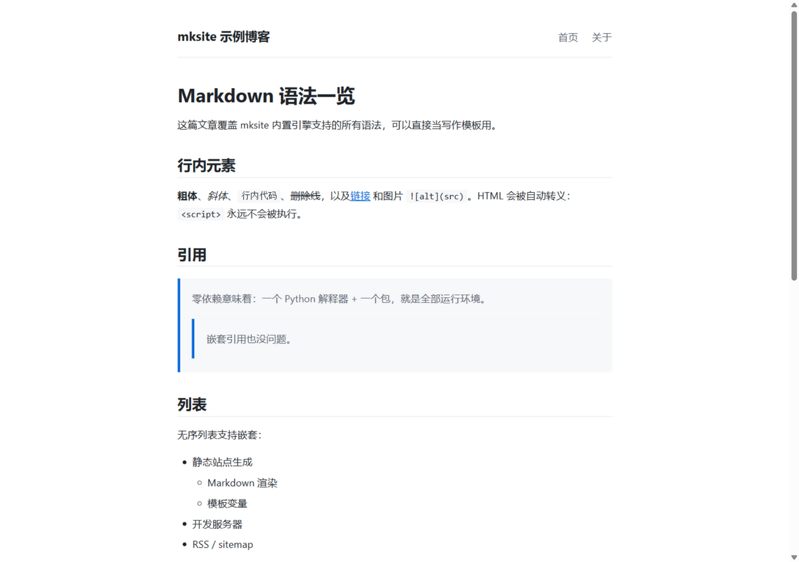

<div align="center">

# mksite

**一个零依赖的静态站点生成器 —— 纯 Python 标准库实现**

[](https://github.com/USER/mksite/actions/workflows/ci.yml)
[](https://www.python.org)
[](LICENSE)
[](#为什么选择-mksite)

[在线示例](https://USER.github.io/mksite/) · [English](README.en.md)



</div>

---

## 为什么选择 mksite

- **零依赖** —— 只用 Python 标准库。没有 `pip install` 一长串包，没有 node_modules；
  甚至可以直接把 `mksite/` 这一个目录拷进你的项目使用。
- **小到能被完整读懂** —— Markdown 引擎、模板渲染、构建管线、开发服务器加起来
  不到 1000 行源码，每一行你都能看懂、随时能改。
- **开箱即用** —— Markdown 渲染（标题 / 表格 / 代码块 / 嵌套列表 / 引用……）、
  RSS 订阅、sitemap、开发服务器自动重建，全部内置。
- **主题就是一个 HTML 文件** —— `{{ 变量 }}` 占位符，五分钟定制你自己的主题。

## 安装

需要 Python 3.9+，仅此而已。

```bash
# 从 GitHub 安装
pip install git+https://github.com/USER/mksite.git

# 或者不安装，直接用仓库源码运行
git clone https://github.com/USER/mksite.git
cd mksite
python -m mksite --help
```

## 快速开始

```bash
mksite init myblog        # 1. 初始化站点
mksite new "我的第一篇文章" -s myblog   # 2. 新建文章
mksite serve -s myblog    # 3. 本地预览 http://127.0.0.1:8000（保存即自动重建）
mksite build -s myblog    # 4. 构建静态文件到 myblog/public/
```

把 `public/` 目录扔到任何静态托管上就能上线：
[GitHub Pages](https://pages.github.com/)、Netlify、Vercel、Cloudflare Pages 均可。

## 目录结构

```
myblog/
├── site.json            # 站点配置：名称、语言、base_url、作者
├── templates/
│   └── page.html        # 页面模板（唯一需要了解的"主题"文件）
├── static/              # 原样复制的静态资源（css/js/图片）
└── content/             # Markdown 页面，目录结构即站点结构
    ├── index.md         # 首页
    └── posts/           # 文章（带 date 字段的页面会自动进入 RSS）
```

## 写作

每个 Markdown 文件开头可以写 front-matter：

```markdown
---
title: 文章标题
date: 2026-10-24
description: 可选的摘要（不写会自动截取正文前 160 字）
tags: [python, ssg]
---

正文从这里开始……
```

模板中可用的变量：`{{ title }}`、`{{ content }}`、`{{ root }}`（相对站点根的
前缀）、`{{ name }}`、`{{ language }}`（来自 site.json），以及 front-matter 里的
任何字符串字段。

## 部署到 GitHub Pages

1. 推送本仓库后，在 **Settings → Pages** 中选择 **Deploy from a branch**，
   分支选 `main`，目录选 `/docs`。
2. 仓库已附带 `.github/workflows/pages.yml`（构建 `example/` 站点并自动部署），
   如需启用，改为 **Settings → Pages → Source: GitHub Actions** 即可。

## 开发

```bash
python -m unittest discover -s tests   # 运行测试（53 个用例）
python -m mksite serve -s example      # 预览示例站点
python -m mksite build -s example -o docs   # 重新构建 docs/（GitHub Pages 用）
```

欢迎 Issue 和 PR！参见 [CONTRIBUTING.md](CONTRIBUTING.md)。

## 项目结构

```
mksite/
├── mksite/              # 核心包（约 1000 行）
│   ├── markdown.py      # Markdown → HTML 引擎
│   ├── frontmatter.py   # 元数据解析
│   ├── templates.py     # {{ 变量 }} 模板渲染
│   ├── build.py         # 构建管线、RSS、sitemap
│   ├── server.py        # 开发服务器 + 文件监听
│   └── cli.py           # init / build / serve / new
├── tests/               # 单元测试
├── example/             # 可运行的示例站点源码
└── docs/                # example 构建产物（GitHub Pages 直接部署）
```

## 许可证

[MIT](LICENSE)
